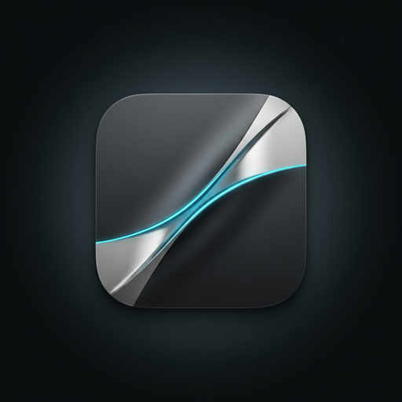
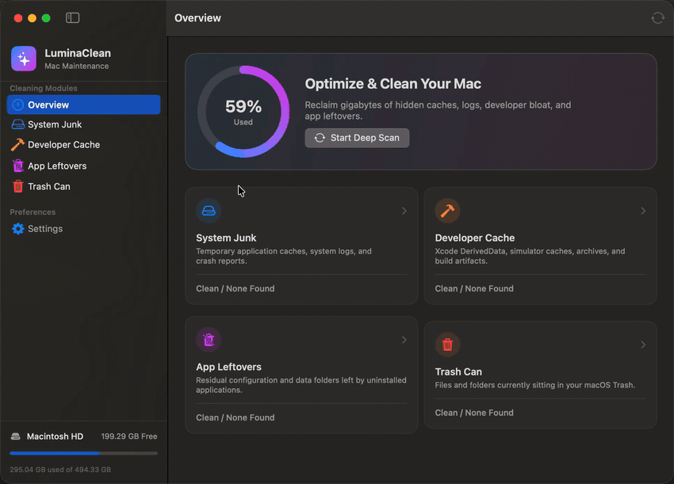
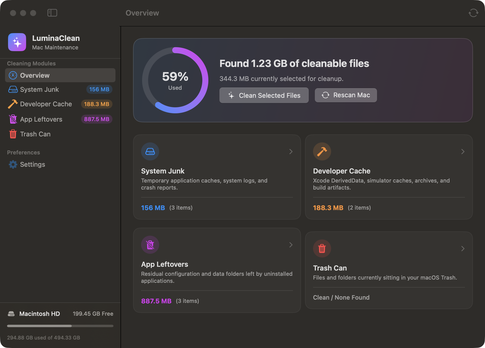
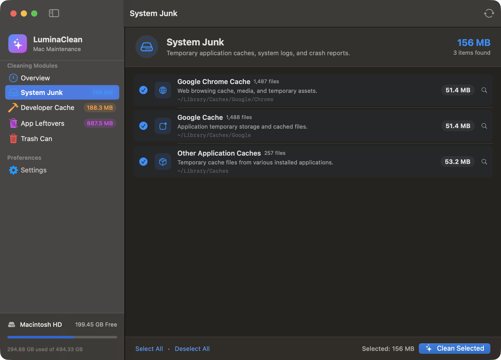
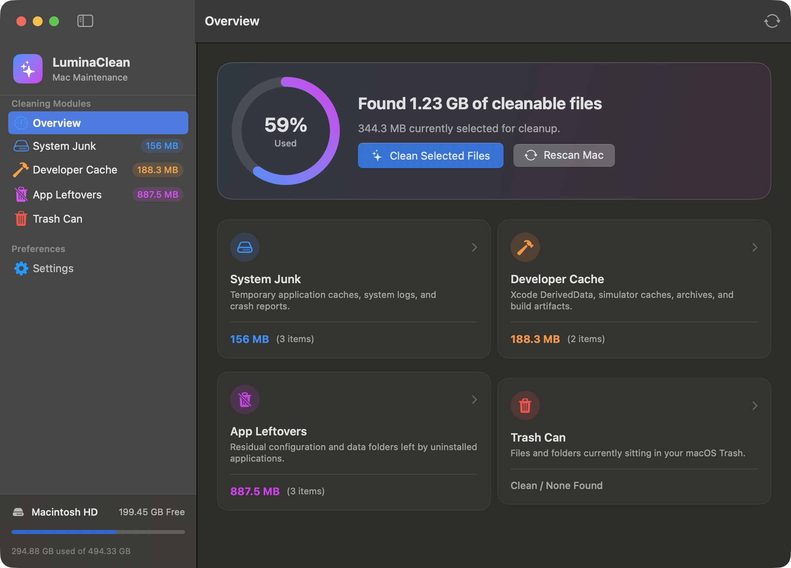

# LuminaClean ⚡️
<p align="center">
  
</p>

<h3 align="center">The Lightweight, Free & Native macOS Junk Cleaner & Optimizer</h3>

<p align="center">
  <a href="https://github.com/sadik254/LuminaClean/releases/latest"></a>
  <a href="LICENSE"></a>
  <a href="https://swift.org"></a>
  <a href="https://apple.com/macos"></a>
  <a href="#"></a>
</p>

<p align="center">
  <b>LuminaClean</b> is a modern, privacy-first, 100% native macOS cleaner and disk optimizer built with <b>Swift & SwiftUI</b>.<br>
  Created as a free, open-source alternative to commercial Mac utility subscriptions ($30–$40/year) that charge users for routine filesystem pruning.
</p>

<p align="center">
  <a href="https://github.com/sadik254/LuminaClean/releases/latest"><b>⚡️ Download Latest Release (.zip)</b></a>
</p>

---

## 🎬 Live Demonstration

<p align="center">
  
</p>

---

## 📸 Screenshots Showcase

<table align="center">
  <tr>
    <td width="50%" align="center">
      <b>Interactive Dashboard & Deep Scan</b><br/>
      
    </td>
    <td width="50%" align="center">
      <b>Developer Cache Inspector</b><br/>
      
    </td>
  </tr>
  <tr>
    <td width="50%" align="center">
      <b>System & Application Caches</b><br/>
      
    </td>
    <td width="50%" align="center">
      <b>Safe Clean Confirmation</b><br/>
      
    </td>
  </tr>
</table>

---

## 🚀 Key Features

* **⚡️ 100% Native macOS Design:** Crafted with modern SwiftUI, SF Symbols, fluid gauge animations, and native Dark & Light mode integration.
* **🛠 Developer Junk Purge:** Reclaim **20GB to 80GB+** of hidden disk hogs:
  * Xcode DerivedData, build archives & iOS DeviceSupport symbols
  * CocoaPods cache, Swift Package Manager cache, npm caches, Homebrew caches, and Gradle artifacts
* **🧹 System & Application Caches:** Safely clear bloated user caches from Spotify, Google Chrome, Slack, Discord, and system log archives.
* **📦 App Leftovers Hunter:** Detects orphaned folders in `~/Library/Application Support` from apps that have already been deleted.
* **🗑 macOS Trash Bin:** Direct inspection and selective purging of your Mac's `.Trash`.
* **🔍 Complete Transparency:** Inspect exact file paths, sizes, and item counts with a **"Reveal in Finder"** button before cleaning.
* **🔒 100% Private & Offline:** Zero analytics, no tracking, no background daemons, no ads, and no network connections.

---

## 🛡 Safety & Security Principles

LuminaClean is built with strict non-destructive guardrails:
1. **System Integrity Protection (SIP) Compliant:** Strictly avoids system binaries, `/System`, `/usr`, and essential OS libraries.
2. **Personal Data Protected:** Documents, Desktop, Downloads, Photos, and user code repositories are never scanned or touched.
3. **Inspect Before Removal:** Quick Finder shortcuts allow checking any file before executing cleanup.

---

## 📂 Project Architecture

```
LuminaClean/
├── Package.swift                    # Swift Package definition
├── bundle.sh                        # One-click native macOS .app bundler
├── LuminaClean.app/                 # Compiled macOS Application Bundle
├── Assets/
│   ├── Icons/                       # Multi-resolution AppIcon assets
│   └── Screenshots/                 # Retina screenshots & animated demo
└── Sources/
    └── LuminaClean/
        ├── LuminaClean.swift        # @main App Entry Point
        ├── Models/
        │   ├── CleanCategory.swift  # Categories enum (System, Dev, Leftovers, Trash)
        │   ├── DiskInfo.swift       # Storage capacity model & percentage helper
        │   └── JunkItem.swift       # Detected junk file/folder model
        ├── Services/
        │   ├── DiskSpaceService.swift  # Volume metrics service
        │   ├── ScannerEngine.swift     # High-speed asynchronous directory scanner
        │   └── CleaningEngine.swift    # Safe removal & cleanup service
        ├── ViewModels/
        │   └── AppViewModel.swift   # MainActor state management (@Observable)
        └── Views/
            ├── ContentView.swift        # Main NavigationSplitView
            ├── SidebarView.swift        # Sidebar navigation & disk meter
            ├── DashboardView.swift      # Overview tab with usage ring & quick tiles
            ├── CategoryDetailView.swift # Detailed list with selection & filters
            ├── ItemRowView.swift        # Item row with path & Finder disclosure
            └── SettingsView.swift       # Privacy & safety principles
```

---

## 🛠 Building & Contributing

### 1. Run Pre-built App
```bash
open LuminaClean.app
```

### 2. Open in Xcode
```bash
open Package.swift
```
Select the **LuminaClean** scheme and press **⌘R** to run.

### 3. Rebuild Application Bundle
To build an optimized release binary and re-package `LuminaClean.app`:
```bash
./bundle.sh
```

---

## 📄 License

This project is open-source under the **[MIT License](LICENSE)**. Feel free to use, enhance, and distribute it freely.
